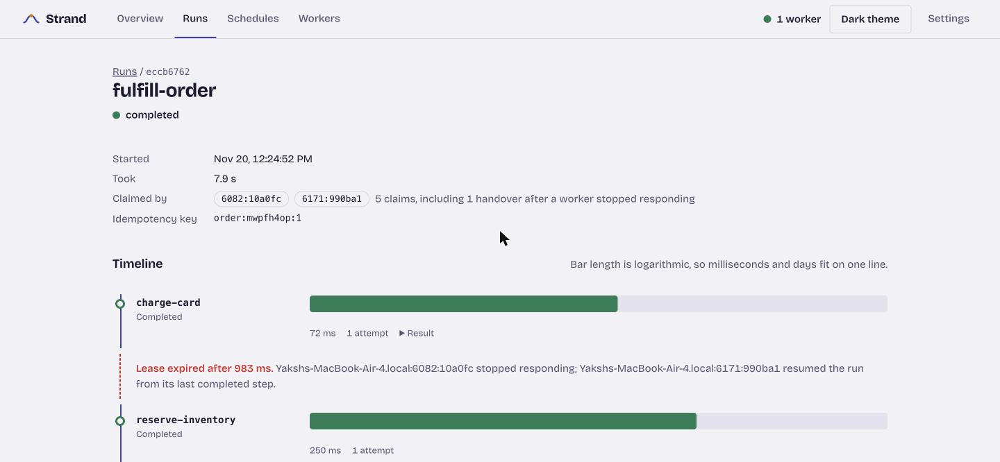
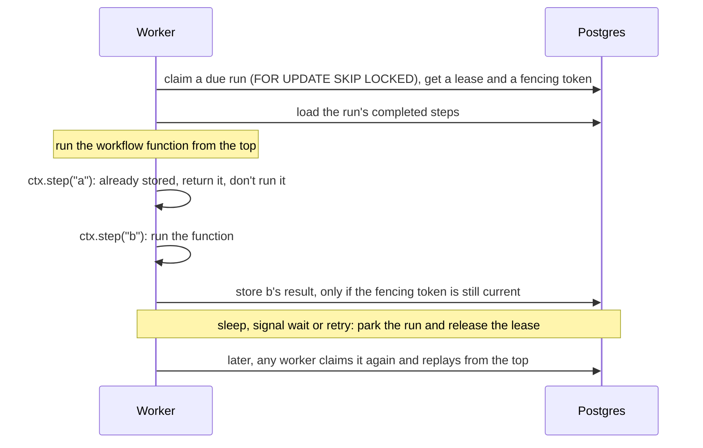

# Strand

[](https://github.com/Yaksh88/strand/actions/workflows/ci.yml)
[](LICENSE)


Durable workflow engine for TypeScript, on Postgres. Write a multi-step process as an ordinary
async function; Strand records each step's result, so the run survives worker crashes, deploys and
restarts, can sleep for days, wait for an outside event, retry with backoff, and run on a cron
schedule. There is no broker and no separate server cluster: Postgres is the only dependency.



## Why

Take an order: charge the card, reserve stock, wait for a fraud review, wait ten minutes, ship. Any
of those can fail halfway, a server can restart between two of them, and the review can take two
days. Without a durable engine you end up hand-writing queues, retry tables and state machines.
With Strand the process is just the function:

```ts
export const fulfillOrder = workflow(
  { name: "fulfill-order", retry: { maxAttempts: 5 } },
  async (ctx, input: { orderId: string; amountCents: number }) => {
    const charge = await ctx.step("charge-card", () =>
      payments.charge(input.orderId, input.amountCents, {
        idempotencyKey: ctx.idempotencyKey("charge-card"),
      }),
    );
    await ctx.step("reserve-inventory", () => inventory.reserve(input.orderId), {
      retry: { maxAttempts: 10 },
    });

    const review = await ctx.waitForSignal<{ ok: boolean }>("fraud-review", { timeout: "2d" });
    if (review.timedOut || !review.payload.ok) {
      await ctx.step("refund", () => payments.refund(charge.id));
      return { status: "refunded" as const };
    }

    await ctx.sleep("cooling-off", "10m");
    await ctx.step("ship", () => shipping.create(input.orderId));
    return { status: "shipped" as const };
  },
);
```

```ts
const worker = new Worker({
  connectionString: process.env.DATABASE_URL!,
  workflows: [fulfillOrder],
});
await worker.start();

const client = new StrandClient({ connectionString: process.env.DATABASE_URL! });
const run = await client.start(
  fulfillOrder,
  { orderId: "o_1", amountCents: 4200 },
  {
    idempotencyKey: "order:o_1",
  },
);
await client.signal(run.id, "fraud-review", { ok: true });
const done = await client.waitForResult(run.id);
```

## Try it

```bash
git clone https://github.com/Yaksh88/strand.git && cd strand
docker compose --profile demo up --build
```

Open <http://localhost:4000>. Two workers run an order-fulfillment workflow against fake services
that are slow, fail 20% of the time, and sometimes fail _after_ doing their work. A ledger keyed by
idempotency key shows each effect applied once however often it was retried.

Or run it from source (Node 22 and a local Postgres):

```bash
pnpm install
createdb strand
export DATABASE_URL=postgres://localhost/strand
pnpm build
pnpm --filter @strand/server start                          # API and dashboard on :4000
pnpm --filter @strand/example-order-fulfillment start       # a worker
pnpm --filter @strand/example-order-fulfillment orders      # start 20 orders
```

## How it works



A workflow is re-run from the top every time it resumes, and `ctx.step` returns the stored result
for steps that already finished, so the function fast-forwards to where it stopped. A worker holds
a time-limited lease on each run and extends it with a heartbeat. If the worker dies, the lease
expires and another worker resumes the run. If it merely stalls and wakes up later, its writes are
refused: every claim gets a larger **fencing token**, and every state change checks it while
holding a row lock. [docs/architecture.md](docs/architecture.md) has the details.

## Guarantees

- A step's **result is committed once.** A worker that lost its lease can never overwrite the work
  of the worker that took over.
- A step's **function may run more than once.** A worker can die after the function succeeds and
  before its result is stored. Make side effects idempotent; `ctx.idempotencyKey(stepName)` gives a
  key that is stable across retries and replays, to pass to external services.
- **Runs are not lost** when workers crash, are killed, or freeze.
- Workflow code must be **deterministic** outside steps: take time from `await ctx.now()` and put
  side effects in steps.

[docs/guarantees.md](docs/guarantees.md) lists what happens in each failure case, including the
ones that are not covered.

### Tested by breaking it

The chaos test kills worker processes with `SIGKILL` and freezes others past their lease with
`SIGSTOP` (so they wake up as zombies) while runs are in flight, then audits the database:

```
1,000 runs of 5 steps, 4 workers, one incident every 800 ms, 2 s leases
  runs completed                      1000 / 1000
  final outputs matching stored steps 1000 / 1000
  workers killed (SIGKILL)            12
  workers frozen past their lease     8
  leases that expired and were taken over  151
  steps whose effect ran more than once    564 (618 extra executions, absorbed by idempotency keys)
```

With the fencing check removed from the step commit, the same test fails: none of the 1,000 runs
complete. Details in [tests/chaos](tests/chaos/README.md).

## Performance

Draining a backlog of 5,000 runs of three no-op steps on an 8 GB Apple M1 laptop, with Postgres on
the same machine:

| Workers | Runs/s | Steps/s |
| ------: | -----: | ------: |
|       1 |  1,921 |   5,762 |
|       2 |  2,429 |   7,288 |
|       4 |  2,705 |   8,116 |
|       8 |  2,303 |   6,909 |

Throughput levels off after two or three workers because Postgres and the workers share one
machine. Runs vary by 10 to 20 percent, and real steps spend their time in the work they do, not in
Strand. See [benchmarks](benchmarks/README.md).

## What's in the repository

| Path                         | What it is                                                                                              |
| ---------------------------- | ------------------------------------------------------------------------------------------------------- |
| `packages/sdk`               | `@strand/sdk`: workflows, `Worker`, `StrandClient`, migrations. [API reference](packages/sdk/README.md) |
| `apps/server`                | REST API, Prometheus metrics and the dashboard host                                                     |
| `apps/dashboard`             | React dashboard: overview, runs, the run timeline, schedules, workers                                   |
| `examples/order-fulfillment` | The demo above                                                                                          |
| `tests/chaos`                | Crash and freeze injection with a database audit                                                        |
| `benchmarks`                 | Throughput benchmark                                                                                    |

## REST API

| Method and path                                       | Purpose                                                    |
| ----------------------------------------------------- | ---------------------------------------------------------- |
| `POST /v1/runs`                                       | Start a run (idempotent with `idempotencyKey`)             |
| `GET /v1/runs`, `GET /v1/runs/:id`                    | List runs; one run with its steps and event timeline       |
| `POST /v1/runs/:id/signals/:name`                     | Send a signal                                              |
| `POST /v1/runs/:id/cancel`, `/retry`                  | Cancel a run; retry a failed one from the step that failed |
| `GET /v1/stats`, `/v1/workflows`, `/v1/workers`       | What the dashboard shows                                   |
| `GET, POST /v1/schedules`, `DELETE /v1/schedules/:id` | Cron schedules                                             |
| `GET /healthz`, `GET /metrics`                        | Health and Prometheus metrics                              |

Set `STRAND_API_TOKEN` to require `Authorization: Bearer <token>` on `/v1`.

## How it compares

|                              | Strand                   | Temporal                                | Inngest                               | BullMQ                  |
| ---------------------------- | ------------------------ | --------------------------------------- | ------------------------------------- | ----------------------- |
| Infrastructure               | Postgres                 | Temporal cluster plus a database        | Hosted service, or self-hosted server | Redis                   |
| Durable multi-step functions | Yes                      | Yes                                     | Yes                                   | No: jobs, not workflows |
| Durability model             | Memoised steps, replayed | Event history with deterministic replay | Memoised steps over HTTP              | Job state in Redis      |
| Languages                    | TypeScript               | Several                                 | Several                               | Node                    |

Strand is a small project that makes one set of trade-offs clear, not a replacement for a mature
platform. If you need workflow versioning, child workflows or a multi-region deployment today,
use Temporal.

## Limitations and roadmap

- No child workflows, concurrency limits per key, or workflow versioning API yet.
- Changing a workflow while runs are in flight is only detected (a `nondeterminism_detected` event),
  not migrated.
- Step results must be JSON-serialisable and are stored in Postgres, so they should be small.
- One Postgres is the single point of coordination; scale is bounded by its write throughput.
- Planned: child workflows, per-key concurrency, OpenTelemetry traces, a versioning API.

## License

[MIT](LICENSE)
